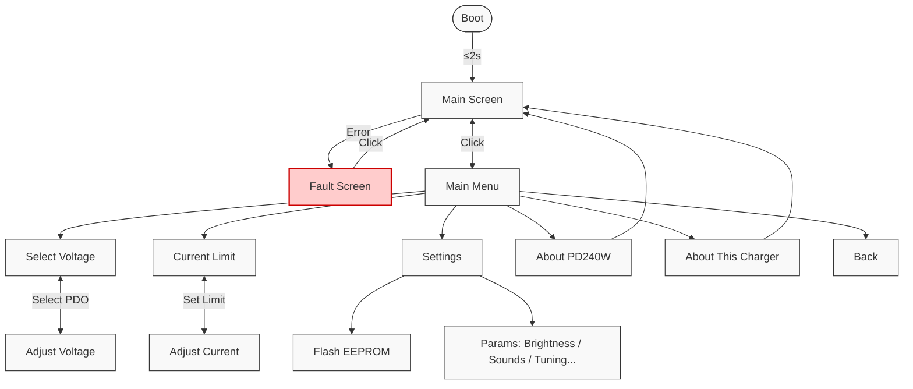

# PD240W

[](https://github.com/theohg/PD240W/releases/latest)
[](https://github.com/RileyCornelius/PD240W/actions/workflows/platformio.yml)


An adjustable power supply for motor drives using USB-C Power Delivery negotiation, supporting up to **240W at 48V 5A**. This device is designed to be compatible with USB-PD up to 3.2. Firmware runs on a Raspberry Pi Pico ([RP2040](https://www.raspberrypi.com/products/rp2040/)).

> [!NOTE]
> This is a fork of [theohg/PD240W](https://github.com/theohg/PD240W) by Théo Heng. The board, enclosure and firmware build differ from the original. See [Fork Changes](#fork-changes).

Follow the latest project logs and updates on <a href="https://hackaday.io/project/205084-pd240w" target="_blank" title="PD240W on Hackaday.io">
Hackaday.io 
</a>

<p align="center">
  
</p>

> [!WARNING]
> **Disclaimer**: Firmware v2.0.0 includes guarded AVS/EPR negotiation, startup restore, and EPR-exit handling, but high-voltage charger interoperability still depends on the source and cable combination you test with. Validate 28V/36V/48V operation on your hardware.

## Table of Contents

- [Fork Changes](#fork-changes)
- [Features](#features)
- [Hardware](#hardware)
- [Quick Start](#quick-start)
- [Controls](#controls)
- [Firmware Structure](#firmware-structure)
- [Want one?](#want-one)
- [Planned Features](#planned-features)
- [Acknowledgements](#acknowledgements)

## Fork Changes

This fork makes these changes to the [original project](https://github.com/theohg/PD240W):

- **5V regulator instead of 17V**: The auxiliary buck regulator (LMR16006X) now outputs 5V instead of the original 17V. Its feedback divider, inductor (now 33µH) and output capacitor (now 22µF 25V) were changed to suit. The firmware has not been updated for this. It still labels the output "17V" on screen, in the CLI and in logs, and still only enables it when VBUS is above 18V.
- **Top case exposes the whole terminal block**: `casing_top` was modified so the entire output terminal block is uncovered.
- **Enclosure recreated in SolidWorks**: The enclosure is now modeled in SolidWorks, in `mechanical/solidworks/`.
- **Production files for the modified board**: The JLCPCB Gerbers, BOM and pick-and-place files for this fork's board are in `hardware/production/`. The files in `hardware/Manufacturing/` and the schematic PDF are from the original 17V board.
- **PlatformIO firmware build**: The firmware builds with PlatformIO from `firmware/` and replaces the original CMake / Pico SDK build. See [Build from Source](#build-from-source).

## Features

- **USB-C Power Delivery**: Negotiates Fixed, PPS (3.3-21V programmable), and AVS (15-48V EPR) profiles
- **Current Limiting**: Adjustable 10mA-5A via INA228 power monitor with hardware overcurrent protection
- **LCD Interface**: 240x320 ST7789 display with anti-aliased fonts and Prusa-style encoder navigation
- **Safety**: Overcurrent ISR, overtemperature monitoring (NTC + INA228)
- **Settings Persistence**: User settings stored in RP2040 flash with CRC32 validation
- **Auto PPS/AVS Tuning**: Closed-loop voltage correction for PPS/AVS charger output accuracy
- **Charger Diagnostics**: On-device PD revision, charger identity, cable inference, and max-power reporting
- **Remote CLI**: USB serial command interface for measurements, PD selection, and settings updates
- **Energy Monitoring**: Tracks mAh delivered since boot via INA228 charge accumulator
- **5V Buck Output**: Optional auxiliary 5V output (17V mock STO/SBC voltage on the original board)
- **Configurable**: Brightness, auto-dim, startup melody, auto-output on boot and more

## Hardware

<p align="center">
  
  
</p>
<p align="center">
  
</p>
<p align="center">
  
</p>

| Type | Path | Contents |
|------|------|----------|
| PCB (KiCad) | `hardware/` | Schematics and PCB layout |
| PCB (STEP) | `mechanical/PD240W_PCB.stp` | Full PCB 3D model |
| Enclosure (SolidWorks) | `mechanical/solidworks/` | Enclosure assembly and part files |
| Enclosure (STEP) | `mechanical/solidworks/STEP/` | Casing top/bottom, knob, button, LCD support, SWD cover |
| Production (this fork) | `hardware/production/` | Gerbers zip, BOM, pick and place for the 5V board (JLCPCB) |
| Gerbers (original) | `hardware/Manufacturing/Fabrication/` | PCB manufacturing files for the original 17V board |
| BOM (original) | `hardware/Manufacturing/Assembly/` | Bill of materials for the original 17V board |
| Pick & Place (original) | `hardware/Manufacturing/Assembly/` | Pick and place file for the original 17V board |

### Hardware Erata

USB data lines (D+/D-) are reversed in the current PCB revision, preventing native USB communication between the RP2040 and the USB host. This can be easily fixed by crossing the D+ and D- lines on the PCB by crossing the series 27Ω resistors as shown below:

<p align="center">
  
</p>

## Quick Start

### Flash Pre-built Firmware

1. Download `PD240W.uf2` from the original project's [latest release](https://github.com/theohg/PD240W/releases/latest). This fork has no releases of its own yet.
2. Hold **BOOTSEL** button on the Pico while connecting USB
3. Drag `PD240W.uf2` to the mounted `RPI-RP2` drive

### Build from Source

Requires: [PlatformIO](https://platformio.org/) (CLI, or the VS Code extension recommended in `firmware/.vscode/extensions.json`). On the first build PlatformIO downloads the toolchain and the [Arduino-Pico](https://github.com/earlephilhower/arduino-pico) core, which bundles the Pico SDK.

```bash
git clone https://github.com/RileyCornelius/PD240W.git
cd PD240W/firmware

pio run                  # Debug build (LOG_DEBUG on)
pio run -e pico_release  # Release build (debug logging off, -Werror)
```

The output binary is `firmware/.pio/build/<env>/firmware.uf2`, where `<env>` is `pico` or `pico_release`. Release downloads rename it to `PD240W.uf2`.

The INA228 and TPS26750 drivers are copied into `firmware/lib/` from [ina228_multiplatform](https://github.com/theohg/ina228_multiplatform) and [tps26750_multiplatform](https://github.com/theohg/tps26750_multiplatform). They do not update automatically. To update one, replace its folder in `firmware/lib/` and bump the version in its `library.json` and in `firmware/src/config/version.h`.

### Run Unit Tests

The host tests cover the hardware-free logic headers and run on your PC, not the Pico. They need a host `g++` on `PATH`:

```bash
cd firmware
pio test -e native
```

See [firmware/test/README](firmware/test/README) for details.

### Flash via SWD

```bash
openocd -f interface/cmsis-dap.cfg -f target/rp2040.cfg \
  -c "adapter speed 5000; program firmware/.pio/build/pico/firmware.elf verify reset exit"
```

> [!IMPORTANT]
> **EEPROM Initial Setup**: Before full PD negotiation can work, you must flash the **TPS26750 EEPROM** configuration. This is done via the **EEPROM Flash** workflow found in the **Settings** menu. 
> 
> **Note**: Before the EEPROM is flashed, the board will only power on when connected to a standard 5V non-PD charger (USB BC1.2 mode).

Once the firmware has been successfully flashed, connect the device to a compatible USB-PD power source and interact with the encoder and buttons to navigate the menus and adjust settings as explained below.

> [!NOTE]
> Finding a compact and affordable charger supporting **USB-PD 3.1** (up to 48V EPR) is currently quite rare. Here are a few known options:
>
> | Model | Max single-port PD Output | Voltage Profile | Approx. Price |
> |---|---|---|---|
> | **[UGREEN Nexode 140W](https://fr.ugreen.com/products/ugreen-nexode-140w-chargeur-usb-c-pd-3-1-3-ports)** | 140W | 28V @ 5A | ~60€ |
> | **[Framework Power Adapter - 180W](https://frame.work/fr/fr/products/16-power-adapter?v=FRANCR000F)** | 180W | 36V @ 5A | ~109€ |
> | **[HKY 240W GaN Charger](https://www.amazon.de/-/en/Charger-Framework-Thunderbolt-External-ADP-240KB/dp/B0FLXY1HYW/ref=sr_1_2?crid=3N3IPHZQ5LLC7&dib=eyJ2IjoiMSJ9.Hby-yLg1Ti0JNivqvDzvN57zIH6zG4_c9wlyL50Z52GmOPyP_vKubcMJ3zNZ7RRcIgOo2FKgZio1hprqALfRdOTl2DQ7Dp27o4l66qmaDQw9ctSuX0EaWnDfyVwVAMaSwnUP7h1NBuraYlZnAgiljw.9cbe3P4mLf8D7-0faSCcJpKki5cfrjZLwFO-zW9XlJw&dib_tag=se&keywords=hky+240w&qid=1769454134&sprefix=hky+240w%2Caps%2C102&sr=8-2)** | 240W | 48V @ 5A | ~90€ |
> | **[Framework Power Adapter - 240W](https://frame.work/fr/fr/products/power-adapter-240w?v=FRAKMX000F)** | 240W | 48V @ 5A | ~120€ |
> | **[UGREEN NEXODE 500W](https://eu.ugreen.com/products/ugreen-nexode-500w-6-port-gan-desktop-fast-charger)** | 240W | 48V @ 5A | ~250€ |

## Controls

| Input | Action |
|-------|--------|
| Encoder Rotate | Navigate menus / Adjust values |
| Encoder Click | Confirm / Select |
| BTN1 (top) | Toggle load switch output |
| BTN2 (bottom) | Toggle 5V buck (firmware still requires VBUS > 18V) |

<p align="center">
  
</p>

### Menu Structure



| Menu Item | Description |
|-----------|-------------|
| Select Voltage | Fixed / PPS / AVS PDO selection |
| Current Limit | 10mA - 5A output current limit adjustment with encoder acceleration |
| Settings | EEPROM flash workflow plus tuning, startup, brightness, and sound options |
| About PD240W | Device identity, firmware build info, flash usage, and project link |
| About This Charger | Live PD revision, CC orientation, QC inference, and cable diagnostics |
| Back | Return to the main live display |

## Firmware Structure

```
firmware/
├── platformio.ini                  Build environments: pico, pico_release, native (tests)
├── lib/
│   ├── ina228_multiplatform/       INA228 power monitor driver
│   └── tps26750_multiplatform/     TPS26750 USB-PD controller driver
├── test/                           Host unit tests (doctest), one folder per suite
└── src/                            Application sources (below)

src/
├── main.cpp                        Entry point, non-blocking main event loop
│
├── hw/
│   ├── hardware.h/cpp              Hardware singleton aggregating all drivers
│   └── interrupts.h/cpp            Centralized GPIO interrupt router (RP2040 single-callback)
│
├── platform/
│   ├── arduino_compat.cpp          Routes the SDK console (printf, getchar) onto the core's UART
│   └── console.h                   Serial console bring-up (logs + CLI)
│
├── cli/                            Serial command interface (see src/cli/README.md)
│
├── config/
│   ├── board_config.h              Pin definitions (Board:: namespace)
│   ├── app_config.h                Timeouts, thresholds, limits (AppConfig:: namespace)
│   └── version.h                   Firmware & hardware version, author...
│
├── drivers/                        Low-level hardware drivers (no business logic)
│   ├── display/
│   │   ├── st7789.h/cpp            SPI LCD driver with AA font rendering
│   │   ├── aa_font.h               Anti-aliased font data structure
│   │   └── font_inter_*.h          Generated Inter font bitmaps (12/14/20/28px)
│   ├── input/
│   │   ├── rotary_enc.h/cpp        Quadrature encoder with velocity tracking
│   │   ├── button.h/cpp            Debounced button with click/long-press
│   │   └── adc_inputs.h/cpp        VBUS voltage + NTC temperature (ADC channels)
│   ├── gpio/                       SimpleIO: digital output with non-blocking blink
│   ├── buzzer/                     PWM buzzer with melody playback
│   └── rgb_led/                    SK6812 via PIO state machine
│
├── logic/                          Application logic
│   ├── state_machine.h/cpp         BOOT -> MAIN <-> MENU <-> ADJUST, FAULT handling
│   ├── safety.h/cpp                Temperature/voltage/current monitoring, fault triggers
│   ├── pd_manager.h/cpp            PD contract caching, PPS keep-alive, auto-tuning
│   ├── settings.h/cpp              Flash persistence with CRC32, debounced saves
│   ├── tps_eeprom_workflow.h/cpp   TPS26750 EEPROM compare/flash state machine
│   ├── cc_controller.h/cpp         Constant-current control via PD voltage requests
│   └── *.h (pure headers)          Host-testable logic: CC regulation, PD diagnostics,
│                                   PPS/AVS tuning, settings storage, thermal monitor
│
├── ui/
│   ├── display_manager.h/cpp       All screen rendering (boot, main, menu, adjust, fault)
│   ├── font_config.h               Central font size mapping (FONT_LARGE/MEDIUM/SMALL)
│   └── assets/pd240w_logo.h        Boot screen logo bitmap
│
├── utils/
│   ├── logging.h                   LOG_INFO/WARN/ERROR/DEBUG/CRITICAL macros
│   ├── pd_voltage.h                Shared programmable-voltage alignment helper
│   ├── tps_eeprom_loader.h/cpp     Low-level TPS26750 EEPROM read/write
│   ├── tps_patch_loader.h/cpp      Pushes the TPS26750 configuration over I2C at boot
│   └── tps26750_patch.c            TPS26750 binary configuration blob
```

## Want one?

<p align="center">
  
</p>

Feel free to order assembled PCBs, flash the firmware, and test it for yourself! Manufacturing 5 assembled PCBs will cost approximately **$415**. 

The project is open for contributions. Don't hesitate to improve the code, report bugs, or suggest new features via Pull Requests and Issues!

## License and Copyright

This repository contains different types of source files, which are licensed as follows:

### 1. Hardware files (CC BY-NC 4.0)
All hardware design files in the `hardware/` directory (Schematics, PCB layout, Gerbers, BOM) and the enclosure files in the `mechanical/` directory are licensed under the **Creative Commons Attribution-NonCommercial 4.0 International License**. 

You are free to download, modify, and build this board for personal, educational, and hobbyist use. However, you may **not** use these designs for commercial purposes (such as manufacturing and selling the boards) without prior written permission.

Please see the [LICENSE.txt](./LICENSE.txt) file for full terms.

### 2. Firmware & Software (MIT License)
The firmware and software source code in this repository (the `firmware/` directory) is licensed under the **MIT License**. 

You are free to use, modify, and distribute the software component of this project. 

Please see the [LICENSE-FIRMWARE.txt](./LICENSE-FIRMWARE.txt) file for full terms.

## Planned Features for V2.1.0+

- **PPS battery charging in Constant Current (CC) mode**: PPS allows a fixed current mode that can be used for battery charging. This is to be tested by charging lithium-ion battery packs.
- **Improved CLI interface**: Needs more testing and polish.
- **Extended PPS and AVS Range**: Support for PPS voltages as low as 3.5V, AND SPR AVS profiles down to 9V.

## Acknowledgements

This project was made possible by [Synapticon GmbH](https://www.synapticon.com), who funded and supported its development. Thank you for providing the resources, hardware, and opportunity to bring PD240W to life.

Inspiration for this project was taken from the great work on portable USB-C PD power supplies by CentyLab on the [PocketPD](https://hackaday.io/project/194295-pocketpd-usb-c-portable-bench-power-supply) project and Alex Xia with his [ProtoV MINI](https://hackaday.io/project/204461-protov-mini-tiny-usb-c-breadboard-power-supply).

All work done on this project, from Hardware design to Firmware development, was done by me, as the sole contributor. I am grateful for the support and feedback from the community, and I hope this project can be a useful resource for anyone interested in USB-C PD power supplies!

***

<p align="center">
  
</p>

 with ❤️ by Théo Heng