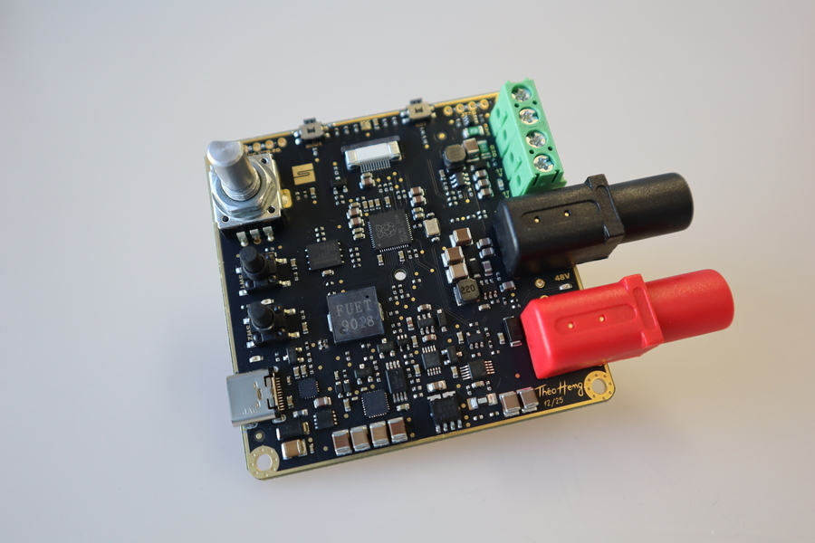
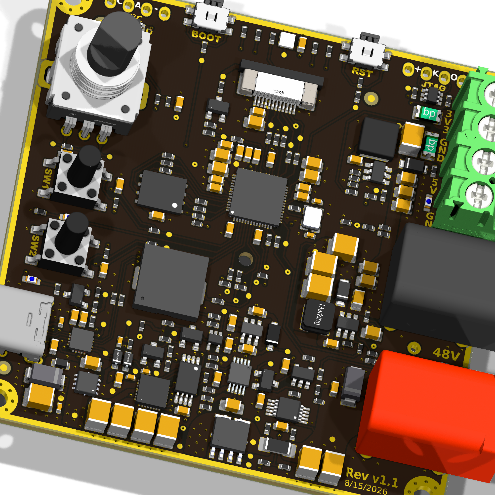
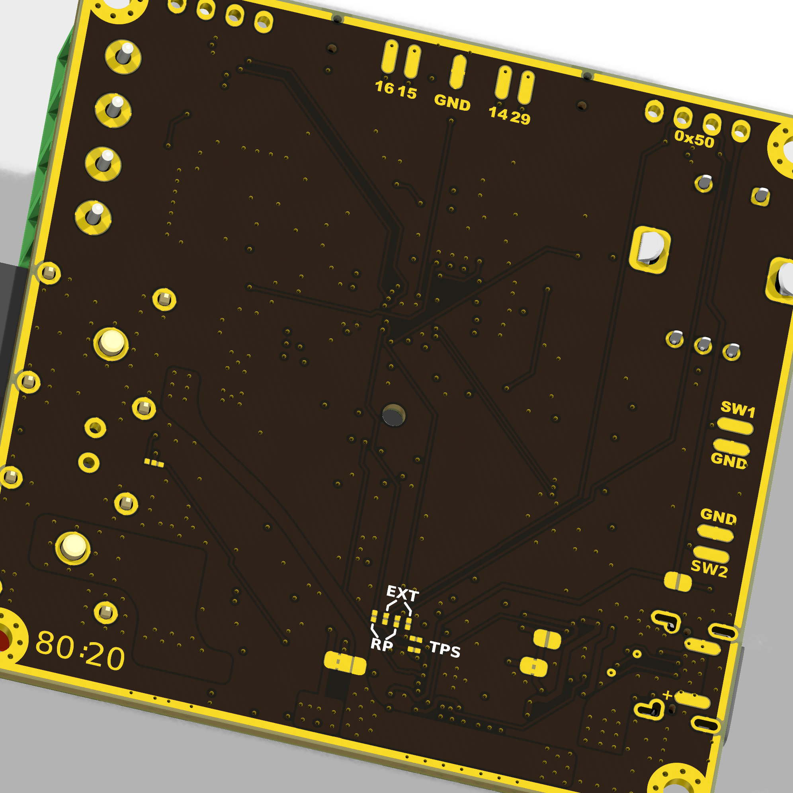

<p align="center" width="100%">
  
</p>

<h1 align="center">PD240W</h1>

<p align="center" width="100%">
    
</p>

***

<p align="center">
  
&nbsp; &nbsp; &nbsp; &nbsp;
  
</p>

***

## SPECIFICATIONS

| Parameter | Value | 
| --- | --- |
| Dimensions | 66.0 × 66.0 mm |
| Input Voltage | 5 - 53 V |
| Output Voltage | 3.3 - 48 V |
| Max. Output Current Voltage | 5 A |
| Max Power Output | 240 W |

***

## DIRECTORY STRUCTURE
```
  ├─ Images             # Pictures, renders, and annotated PCB images
  ├─ kibot_resources    # KiBot report templates, scripts, and color theme
  ├─ kibot_yaml         # KiBot configuration (KDT_Hierarchical_KiBot)
  ├─ lib                # KiCad footprint and symbol libraries
  │  ├─ lib_fp          # Footprint libraries
  │  └─ lib_sym         # Symbol libraries
  ├─ Logos              # Project logos used in the PCB design package
  ├─ Manufacturing      # Assembly and fabrication deliverables (KiBot)
  │  ├─ Assembly        # BoM, placement, and assembly notes
  │  └─ Fabrication     # Fabrication exports and release bundles
  ├─ production         # JLCPCB order files (Fabrication Toolkit plugin)
  ├─ Schematic          # Exported schematic documentation
  ├─ Templates          # KiCad title block templates
  └─ CHANGELOG.md       # Hardware revisions, shown on the Revision History sheet
```

***

## PRODUCTION FILES

Two sets of production files are generated from the same KiCad project:

- `production/`: the JLCPCB order package (Gerbers zip, BOM, pick and place), generated with the JLCPCB Fabrication Toolkit plugin in KiCad.
- `Manufacturing/` and `Schematic/`: the full documentation package (Gerbers, drill files, ODB++, BOM, pick and place, interactive BOM, fabrication and assembly drawings, schematic PDF), generated with KiBot using a [KDT_Hierarchical_KiBot](https://github.com/nguyen-v/KDT_Hierarchical_KiBot) configuration.

Regenerate both after changing the schematic or PCB.

***

## REGENERATING THE KIBOT OUTPUTS

KiBot runs in Docker. From this `hardware/` folder:

```bash
docker run --rm -v "$(pwd)/..:/repo" -w /repo/hardware ghcr.io/inti-cmnb/kicad10_auto_full:latest bash -c "
  git config --global --add safe.directory '*' &&
  kibot --skip-pre set_text_variables,draw_fancy_stackup,erc,drc -c kibot_yaml/kibot_main.yaml -d . -g variant=RELEASED -E REVISION=1.1.0 notes &&
  kibot -c kibot_yaml/kibot_main.yaml -d . -g variant=RELEASED -E REVISION=1.1.0 netlist bom fab_k9 assembly pdf_schematic"
```

Then rename `Schematic/PD240W_kicad-schematic.pdf` to `Schematic/PD240W-schematic_<revision>.pdf`.

Notes:

- The run modifies `PD240W_kicad.kicad_pcb` and `PD240W_kicad.kicad_pro` (stackup drawing, tables, git hash and release text variables). Discard those changes with `git checkout` unless you want to keep them.
- The title blocks use Arial and Times New Roman. KiBot installs them from `kibot_resources/fonts/`, which is not committed. Copy that folder from the KDT_Hierarchical_KiBot repository, or the PDFs fall back to a different font.
- Add a `## [x.y.z] - YYYY-MM-DD` entry to `CHANGELOG.md` and enable that version in `kibot_yaml/kibot_pre_set_text_variables.yaml` to show it on the Revision History sheet.
- The run stops on ERC errors. DRC currently reports 5 errors that are also present in the original board (J1 mounting-slot annular rings and a zero-length GND track near Q6); these do not stop the run.